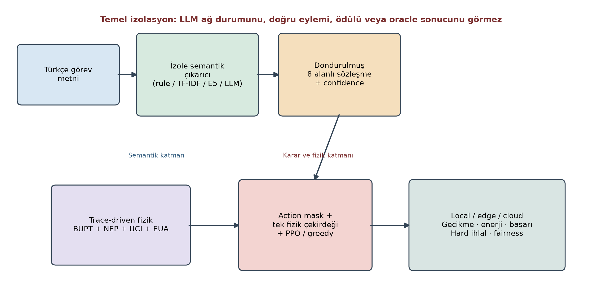
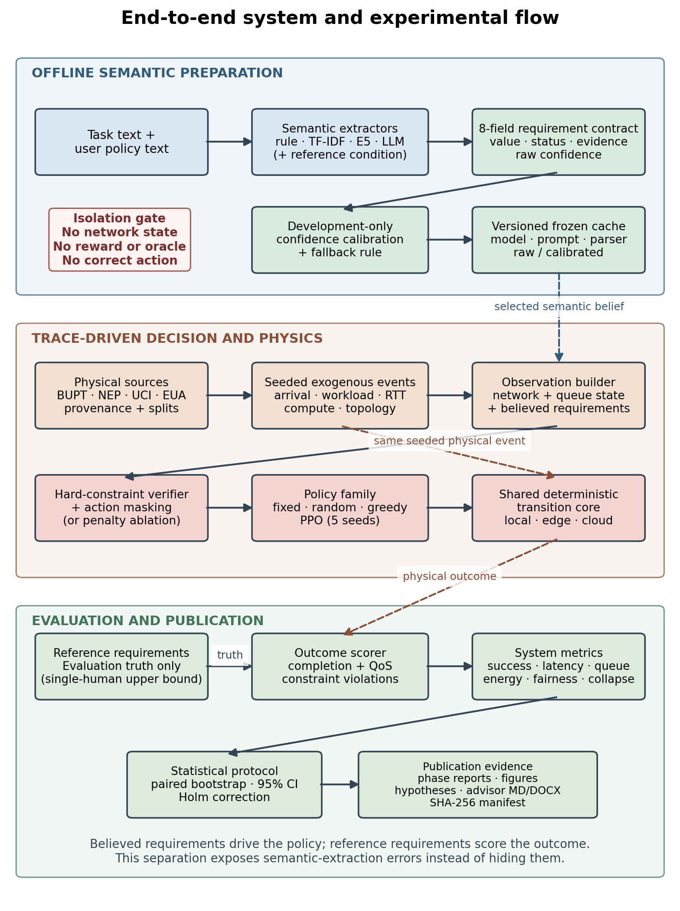
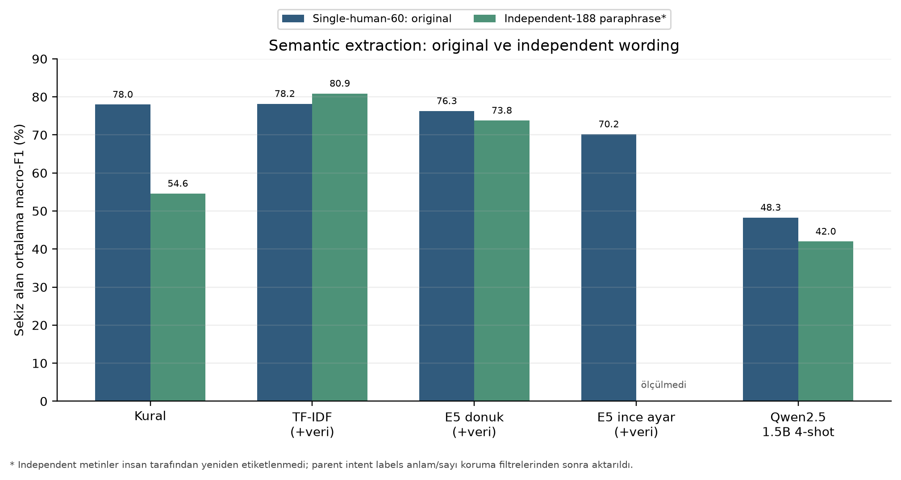
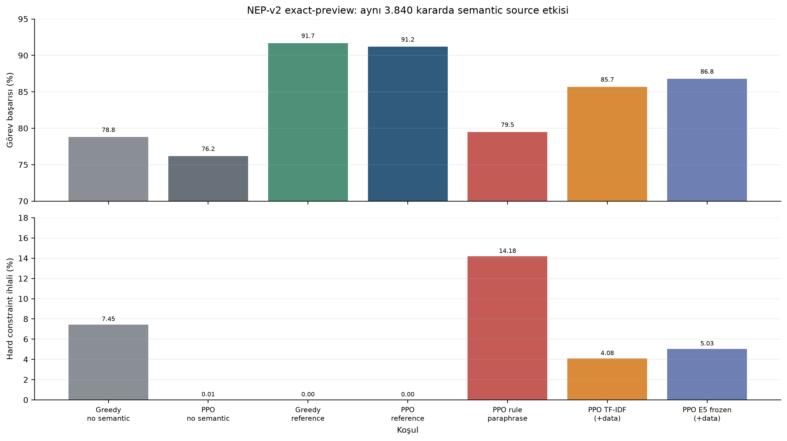
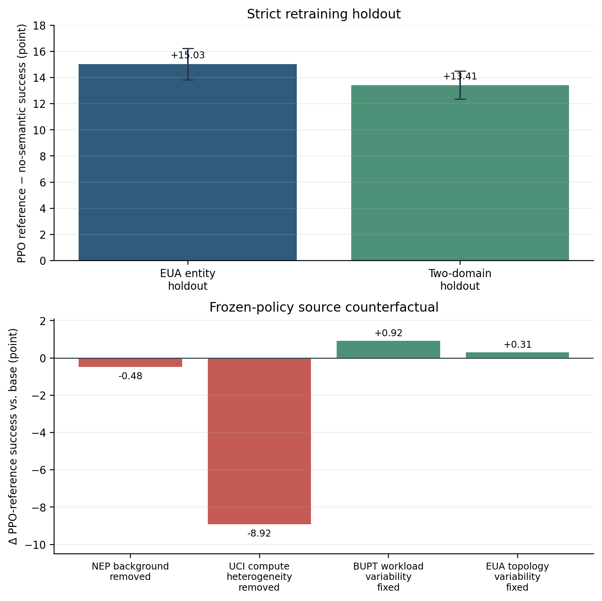

# Tez Danışmanı İçin Mevcut Durum, Yöntem, Bulgular ve Makale Yol Haritası

**Güncellik tarihi:** 27 Kasım 2026

**Önerdiğim Türkçe tez başlığı:** Belirsizlik-Duyarlı Semantik Kısıtlarla İz Güdümlü Mobil Uç Bilişimde Görev Boşaltma

**Önerdiğim İngilizce tez başlığı:** Trace-Driven Task Offloading in Mobile Edge Computing with Uncertainty-Aware Semantic Constraints

**Belgenin amacı:** Bu belgede tez kapsamında hangi problemi çözdüğümü, veriyi nasıl oluşturup ayırdığımı, hangi yöntemleri neden kullandığımı, hangi metriklerin hangi riski ölçtüğünü, elde ettiğim olumlu ve olumsuz sonuçları ve makaleye geçmeden önce gerçekten kalan işleri danışmanıma açık biçimde sunuyorum.

> **Kanıt durumu:** Semantik benchmark v3.2, NEP-v2 exact/noisy/independent offloading deneyleri, EUA entity holdout, iki-domain holdout, dört source-layer counterfactual ve Phase 10 reproducibility/quality gate tamamlandı. Ana PPO koşulları 5 independent training seed × 150.000 step; her değerlendirme 60 episode × 64 task = 3.840 paired decision içeriyor. Sonuçlar gerçek testbed değil, provenance-korumalı **trace-driven-hybrid simulation** sonucudur. Bu sınırı makale ve tez boyunca koruyacağım.

> **Terminology convention:** Literatürde yerleşik teknik terimleri anlam kaybını
> önlemek için English biçimleriyle kullanıyorum. Türkçe metin bu terimlerin ne
> yaptığını açıklıyor; ancak terimin kendisini çevirmiyorum. Örneğin “kesin kısıt
> ihlali” yerine **hard constraint violation**, “güven aralığı” yerine
> **confidence interval (CI)** ve “eylem maskeleme” yerine **action masking**
> kullanıyorum.

| Standard technical term | Bu belgedeki anlamı |
|---|---|
| `task offloading` | Bir task'in `local`, `edge` veya `cloud` üzerinde çalıştırılmasına karar verme problemi |
| `semantic extractor` / `semantic requirement contract` | Natural-language task text'ten sekiz alanlı, denetlenebilir requirement yapısı çıkaran katman ve çıktısı |
| `task success rate` | Physical completion ile semantic QoS/constraint koşullarının birlikte sağlanma oranı |
| `hard constraint violation rate` | Privacy veya execution prohibition gibi kesin kuralların ihlal oranı |
| `confidence calibration` / `fallback` | Raw confidence'ı development data ile düzeltme ve düşük confidence durumunda alternatif profile geçme |
| `action masking` / `penalty` | Invalid action'ı seçimden kaldırma veya reward içinde cezalandırma yaklaşımları |
| `holdout` / `ablation` / `counterfactual` | Genelleme için grubu testte tutma, bileşen çıkarma ve frozen policy altında evaluation distribution değiştirme deneyleri |
| `paired bootstrap`, `95% CI`, `Holm correction` | Aynı evaluation events üzerinde uncertainty ve multiple-testing kontrolü |
| `tail latency`, `policy collapse`, `decision overhead` | Uç gecikmeler, tek action'a yığılma ve policy inference süresi |

## 1. Yönetici özeti

Bu çalışmada doğal dille verilen bir IoT/MEC görevini doğrudan LLM'ye “local, edge veya cloud seç” diyerek çözdürmüyorum. Önce görev metninden sekiz alanlı ve denetlenebilir bir **semantic requirement contract** çıkarıyorum. Ardından bu sözleşmeyi BUPT, NEP, UCI ve EUA kaynaklarıyla koşullandırılan ortak fizik çekirdeğine veriyor; offloading kararını güçlü bir greedy heuristic veya PPO ile alıyorum. Semantic extractor; network state, reward, oracle veya doğru action'ı görmüyor. Bu izolasyon sayesinde dil anlama hatası ile karar politikası hatasını ayrı ölçebiliyorum.

Pratikte izlediğim end-to-end işlem sırası şöyledir:

1. Natural-language task text'i alıyorum.
2. `Semantic extractor` ile sekiz alanlı `semantic requirement contract` üretiyorum.
3. Raw prediction, calibrated confidence, model revision ve parser output'unu PPO training başlamadan önce donduruyorum.
4. BUPT, NEP, UCI ve EUA katmanlarından provenance-korumalı physical events oluşturuyorum.
5. Aynı events üzerinde fixed, random, greedy ve PPO policy ailelerini karşılaştırıyorum.
6. `Task success rate`, `hard constraint violation rate`, latency, queue, throughput, energy, fairness, `policy collapse` ve `decision overhead` metriklerini ölçüyorum.
7. Exact/noisy preview, independent paraphrase, entity/domain holdout ve source-layer counterfactual deneyleriyle sonucun ne kadar genellenebildiğini test ediyorum.

Çalışmanın ana bulguları şunlardır:

1. **Prompt-only LLM'ler, 8B ölçeğinde bile supervised baselines'ı geçmedi; fakat bu eşit eğitim bütçeli bir mimari karşılaştırması değildir.** Single-human-60 özgün metinde macro-F1; rule için `%78,0`, TF-IDF(+data) için `%78,2`, frozen E5(+data) için `%76,3`, fine-tuned E5 için `%70,2`, Qwen2.5-1.5B 4-shot için `%48,3` oldu. Aynı ölçümde Qwen3-8B 0/4/8-shot `%50,2 / %55,4 / %54,8` verdi. En iyi koşul 4-shot'tır; 8-shot kalite artırmadı fakat gecikmeyi yaklaşık iki katına çıkardı (`9,5→19,4` s/görev). Qwen modellerinin ağırlıkları task-specific eğitilmedi; development etiketleri yalnız çıktı sözlüğünü tanımladı ve promptta yalnız `k` paired demonstrasyon kullanıldı.
2. **Asıl ayrım paraphrase robustness altında oluştu.** Rule, makine yeniden yazımında `%40,3` macro-F1'e düştü; TF-IDF(+data) `%67,9` elde etti. Görülmemiş kompozisyonel ifadelerde rule `%47,5`, TF-IDF(+data) `%73,6`, frozen E5(+data) `%70,9` oldu.
3. **Doğru semantik bilgi NEP-v2 sistem sonucunu belirgin artırdı.** Exact-preview koşulunda reference semantics, no-semantic'e göre `task success rate` değerini PPO'da `+15,03` percentage point [95% CI `+13,85; +16,27`], greedy'de `+12,94` point [95% CI `+11,77; +14,12`] artırdı.
4. **Extractor quality downstream safety'yi doğrudan etkiledi.** PPO'da rule-paraphrase `%14,18` `hard constraint violation rate` üretirken TF-IDF(+data) `%4,08`, frozen E5(+data) `%5,03`, single-human reference `%0,00` üretti. Rule yerine TF-IDF kullanımı `hard constraint violation rate` değerini `10,10` point azalttı.
5. **PPO, güçlü greedy baseline'ı geçmedi.** Reference koşulunda greedy `%91,7`, PPO `%91,2` success verdi. Noisy-preview ve domain holdout'ta da PPO üstünlüğü desteklenmedi. Bu negative result gizlenmiyor; makalenin dürüst deneysel sonucudur.
6. **Semantic state policy collapse'ı azalttı.** No-semantic PPO'nun max-action share değeri `%99,7` iken reference PPO'da `%72,3` oldu. Buna rağmen greedy daha düşük latency, energy/success ve decision overhead sağladı.
7. **Ana yön generalization kontrollerinde korundu.** EUA entity holdout'ta semantic PPO avantajı `+15,03` point, two-domain holdout'ta `+13,41` point oldu; her iki koşulda reference `hard constraint violation rate` `%0,00` kaldı.
8. **Calibration/fallback evrensel bir güvenlik garantisi değildir.** Development-only isotonic calibration confidence ölçümünü bazı modellerde iyileştirdi; fakat fallback yalnız PPO/TF-IDF koşulunda önceden tanımlı başarı-güvenlik kapısını geçti. H3 bu nedenle desteklenmedi.
9. **Veri miktarı ve wording çeşitliliği belirleyici oldu.** D180'den D1924'e geçiş human rewrite'ta TF-IDF macro-F1'i `+19,8`, frozen E5'i `+8,6` puan; independent-188'de sırasıyla `+36,9` ve `+22,1` puan artırdı. Bu bulgu yeni, daha büyük ve insan denetimli ortak benchmark genişletmesini gerekçelendiriyor.
10. **Eşit ve daha çeşitli supervision ile fine-tuned E5 ilk kez en iyi yöntem oldu (geçici sonuç).** Bütün supervised yöntemler aynı 3.024 satırlık, eski test senaryolarından tamamen arındırılmış Expanded-v2 train'i ile eğitildi. Hiç görülmemiş 32 cihazdan oluşan testte macro-F1 şöyledir: fine-tuned E5 `%89,3`, TF-IDF `%87,6`, frozen E5 `%84,5`, rule `%79,7`. Fine-tuned E5, TF-IDF'i v2 testte `+1,7` puan [95% CI `+0,1; +2,8`], Independent-188'de `+3,8` puan [`+0,8; +7,6`] geçti. Küçük veride bu sıralama tersti. Aynı TF-IDF eski şablon testinde `%99,4` aldığı için yeni test, şablon tanımadan çok gerçek genellemeyi ölçmektedir. Etiketler henüz construction label olduğundan bu sonuçlar insan etiketlemesi sonrası yeniden üretilecektir.

Bugün savunabildiğim ana sonuç şudur:

> Natural-language semantics, MEC task offloading'i ancak extractor paraphrase-robust olduğunda, uncertainty development-only calibration ile ele alındığında ve hard permissions deterministic verification/action masking ile sınırlandığında güvenli biçimde iyileştiriyor. Aksi durumda semantik katman no-semantic policy'den daha fazla hard violation üretebiliyor.

### 1.1 İş paketlerinin güncel durumu

| İş paketi | Durum | Depodaki ana kanıt | Kalan |
|---|---|---|---|
| Faz 0–3: research contract, simulator, provenance/split | **Tamamlandı** | Faz 0–3A raporları, oracle/parity/leakage testleri | — |
| Faz 4: semantic benchmark v3.2 | **Tamamlandı; genişletme aktif** | Human-60, 600+600 compositional, independent-188; constant/rule/TF-IDF/E5/Qwen2.5; Qwen3-8B 0/4/8-shot; Expanded-v2 ve kör annotation paketleri | Expanded-v2 iki kişilik insan annotation/adjudication, Qwen3-8B QLoRA ve ortak final yeniden eğitim |
| Faz 5: baselines/oracle/reward | **Tamamlandı** | NEP-v2 fixed/random/greedy, oracle, reward decomposition/sensitivity | — |
| Faz 6: PPO ve semantic ablation | **Tamamlandı** | Exact/noisy/independent; calibration, mask/penalty; H1–H6 | — |
| Faz 7: generalization/source ablation | **Tamamlandı** | Temporal, entity, scenario-family proxy, domain holdout ve source counterfactual | Claim sınırlarını tez metninde korumak |
| Faz 8: GNN/recurrent/partial offloading | **Koşullu; aktif backlog değil** | Bu karmaşıklıkları zorunlu kılan kanıt yok | Ancak yeni hipotez ve adil ablation bütçesi açılırsa |
| Faz 9: physical testbed/emulation | **Opsiyonel** | Simülasyon testbed diye sunulmuyor | Yapılırsa ayrı sim-to-real çalışma |
| Faz 10: tez/makale ve reproducibility | **Current-PC core tamamlandı** | Frozen suite/evidence, tek-komut rehber, Phase 10 raporu; 264 test + Ruff + strict mypy; publication-core commit `03dee8e` | Quadro extension opsiyonel |

Eski çekirdek deneyler tamamlandı; ancak danışman geri bildirimi sonrasında semantic benchmark genişletmesi yeni aktif iş paketidir. Yeni turda bütün supervised extractor'lar aynı Expanded-v2 train/validation/test üzerinde yeniden eğitilecek; Qwen3-8B 0/4/8-shot ayrı in-context track, QLoRA ise aynı supervised data track içinde raporlanacaktır. Prompt-only track tamamlandı; supervised track'in geçici construction-label sonuçları alındı; final tablo iki kişilik insan etiketlemesinden sonra üretilecektir.

## 2. Araştırma problemi, araştırma sorusu ve kapsam

Klasik MEC offloading çalışmaları çoğunlukla task input size, CPU cycles, deadline ve energy budget gibi gereksinimleri baştan sayısal ve eksiksiz kabul eder [18]. Gerçek kullanıcı ise “hasta verisi cloud'a çıkmasın”, “alarm hemen değerlendirilsin” veya “yaklaşık sonuç yeterli fakat pil tüketimi düşük olsun” gibi doğal dil kullanabilir. Burada iki ayrı problem vardır:

- **Semantic problem:** Kullanıcının/görevin gereksinimi nedir?
- **Physical decision problem:** O anda device, network, edge ve cloud hangi action'ı güvenli ve verimli biçimde gerçekleştirebilir?

Ana araştırma sorum şudur:

> RL training'den önce dondurulmuş ve yalnız task text'ten çıkarılmış structured semantic requirements; aynı MEC physics, aynı evaluation tasks ve aynı random seeds altında no-semantic ve daha basit semantic baselines'a göre task success, hard-constraint satisfaction ve generalization'ı iyileştiriyor mu?

Alt sorularım şunlardır:

1. Rule, TF-IDF, multilingual E5, small LLM ve single-human reference arasında semantic quality nasıl değişiyor?
2. Semantic quality farkı downstream success ve violation metriklerine nasıl yansıyor?
3. PPO, güçlü greedy heuristic üzerinde gerçekten ek değer sağlıyor mu?
4. Exact/noisy preview, entity/domain shift ve physical source counterfactual altında etki yönü korunuyor mu?
5. Calibration, fallback ve action masking hangi koşullarda faydalı veya zararlı oluyor?

Çalışma atomic task için `local / edge_i / cloud` action space kullanır. Partial offloading, continuous resource allocation, GNN policy veya recurrent policy mevcut araştırma sorusunun parçası değildir. Bu özellikleri başlıkta veya katkı iddiasında kullanmıyorum.

## 3. Tasarladığım mimari

İkinci flow diagram, offline semantic preparation ile trace-driven decision,
shared physics core ve evaluation/publication katmanlarını uçtan uca gösterir.
`Believed requirements` policy input'udur; `reference requirements` ise outcome
scoring için ayrı tutulur. Böylece semantic extraction error sistem sonucunda
gizlenmeden ölçülür.

Mimari şu güvenilirlik ilkelerine dayanır:

1. **Semantic isolation:** Extractor yalnız task text ve varsa user policy text görür. Network state, reward, oracle ve correct action gizlidir.
2. **Frozen interface/cache:** Çıktı sekiz alanlı JSON contract'tır. Model revision, prompt, parser, raw/calibrated confidence ve predictions PPO'dan önce sürümlenir.
3. **Shared physics:** Fixed, random, greedy ve PPO aynı deterministic transition core, queue, latency, energy, reliability ve accuracy denklemlerini kullanır.
4. **Hard vs. soft constraints:** Explicit execution prohibitions `action masking` ile kapatılır. Energy priority gibi tercihler reward bileşenidir. Invalid action masking'in policy-gradient yöntemlerinde teorik olarak geçerli ve pratikte önemli olduğu gösterilmiştir [11].
5. **Belief/truth ayrımı:** Policy ve mask `believed_requirements` kullanır; success/violation gerçek reference requirements ile ölçülür. Böylece yanlış semantics'in zararı gizlenmez.
6. **Uncertainty provenance:** Raw confidence ile development-only calibrated confidence ayrı artifact olarak tutulur; legacy/raw cache “calibrated” diye adlandırılmaz [12].
7. **Paired evaluation:** İki yöntem aynı tasks ve exogenous events üzerinde karşılaştırılır; policy dışı varyans azaltılır.

Bu ayrıştırma STEPS'in semantic contract yaklaşımı ve AgentVNE'nin natural-language constraints'i optimization/RL katmanına çevirme fikriyle akrabadır [1], [2]. Ancak benim çalışmamda LLM doğrudan scheduler değildir; sekiz alanlı contract, explicit privacy/execution action masking ve extractor-error → system-effect analizi merkezde yer alır. IoT-Brain ve MAS-DecStream'de de açık uçlu dil katmanı ile deterministic physical/QoS verification'ın ayrılması benzer güvenlik gerekçesine dayanır [6], [7].

### 3.1 Sekiz alanlı semantic contract

| Alan | Çıkarılan bilgi | Sistemdeki rol |
|---|---|---|
| `domain` | healthcare, industry, transportation, public safety vb. | Domain error slice ve holdout; tek başına action emri değil |
| `latency` | Deadline class ve varsa numeric value | Deadline miss ve suitability |
| `privacy` | Sensitivity level | Privacy raporu; execution policy ile birleştiğinde hard restriction |
| `execution_policy` | İzinli/yasak local-edge-cloud locations | `Action masking` üreten temel hard constraint |
| `reliability` | best-effort/high/mission-critical veya numeric target | Node/link reliability suitability |
| `accuracy` | Required result quality | Node/model accuracy suitability |
| `energy_priority` | Energy-saving preference veya açık budget | Soft reward; explicit budget varsa constraint |
| `divisibility` | Task bölünebilir mi? | Atomic action-space kontrolü; partial offloading için gelecekteki gate |

Her alan yalnız class label içermez; `stated / not_stated / unknown / conflicting`, evidence span ve confidence de taşır. Metinde söylenmeyen gereksinimi uydurmamak, doğru class kadar önemlidir. STEPS'in confidence/semantic uncertainty yaklaşımı [1] ve calibration literatürü [12] bu tercihi destekler.

## 4. Veri nasıl elde edildi ve nasıl kullanıldı?

Tam eşleşmiş “Türkçe task intent + sekiz semantic label + MEC telemetry + offloading action/outcome” açık veri seti bulamadım. BINS ve NIT intent translation için değerlidir; ancak bizim local/edge/cloud physics ve sekiz alanı birlikte sağlamaz [23], [24]. Bu nedenle semantic corpus ve physical traces ayrı kaynaklardan, açık provenance ve claim sınırlarıyla kullanıldı.

### 4.1 Semantic corpus

| Bölüm | Boyut | Label kaynağı | Kullanım ve sınır |
|---|---:|---|---|
| Kontrollü Türkçe ana corpus | 240 | 180 machine-weak label + 60 single-human reference | Family-disjoint development/evaluation |
| Pilot annotation | 20 | İnsan | Protocol quality; ana score'a karıştırılmadı |
| Augmented training pool | 1.924 | Construction/machine augmentation; 180 temel görevden türetildi | Yalnız training; evaluation labels görülmedi |
| Human-60 machine rewrite | 60 | Original single-human label transfer | İnsan rewrite metnini yeniden etiketlemedi |
| Compositional | 600 template + 600 unseen wording | Label by construction | Composition/wording robustness |
| Independent paraphrase | 200 adaydan 188 kabul | Parent-intent label transfer + automatic preservation filters | Son robustness; yeni human gold değil |

`scenario_family_id` ve `paraphrase_family_id` development/evaluation arasında ayrıdır. Duplicate hash, family overlap, chronology ve train-only normalizer otomatik kontrol edilir. Daha önce tespit edilen wording leakage giderilmiş ve yalnız leakage-free v3/v3.2 sonuçları kullanılmıştır.

Cached v3.2 scorer içinde görülen `1.980` sayısı sabit yazılmış metadata hatasıdır; güncel training task/label dosyaları ve authoritative `results.v3.json` `1.924` satır içerir. Bu satırlar 1.924 bağımsız görev değildir; 180 temel development metninin paraphrase ve compositional türevleridir.

### 4.1.1 Genişletilmiş ortak benchmark: Expanded-v1'den Expanded-v2'ye — 27 Kasım 2026

Danışman geri bildirimindeki veri sayısı ve çeşitliliği sınırlamasını ele almak için önce 600 senaryo aileli bir aday (Expanded-v1) üretildi. Bu adayın kendi split'i aile düzeyinde temiz görünse de çapraz denetim iki sızıntı yolu ortaya çıkardı:

1. **Eski testlere sızıntı:** Human-60, Comp-600 ve Independent-188'in tamamı Human-60'ın 30 cihaz/işlem bağlamından türemiştir. Expanded-v1 aynı senaryo dosyasından üretildiği için 600 ailenin 244'ü bu bağlamları yeniden kullandı. Yeni train'de Human-60 original'dan 3, Comp-600'den yaklaşık 93 birebir metin bulunuyordu.
2. **Split'ler arası cihaz/işlem geçişi:** Bir cihaz farklı işlemlerle birden fazla aileye girdiği için 120 cihazın 98'i ve 120 işlemin 103'ü birden fazla split'te görünüyordu.

Bu nedenle Expanded-v1 geri çekildi ve **Expanded-v2** oluşturuldu:

- Eski değerlendirme setlerinin 30 bağlamı bütün split'lerden çıkarıldı. Bu bağlamların cihaz ve işlem adları hiçbir yeni metinde geçemez.
- Her domain için 20 yeni cihaz ve her cihaza ait 3 doğal işlem elle yazıldı (toplam 160 cihaz, 480 işlem).
- Split birimi **cihaz grubu** oldu: Bir cihaz bütün işlemleriyle tek split'e atanır.
- Validation ve test yalnız hiçbir eski artifact'te geçmemiş yeni cihazlardan oluşur. Temiz eski development bağlamları yalnız train'e girer.

| Birim | Toplam | Train | Validation | Test |
|---|---:|---:|---:|---:|
| Bağımsız cihaz grubu | 250 | 186 | 32 | 32 |
| Senaryo ailesi (cihaz + işlem) | 570 | 378 | 96 | 96 |
| İlişkili metin satırı (aile × 4 semantik profil × 2 ifade) | 4.560 | 3.024 | 768 | 768 |

Build betiği dokuz sızıntı denetimini zorunlu tutar ve herhangi biri sıfırdan farklıysa durur:

- duplicate metin;
- cihaz grubu, profil, cihaz ve işlem için split'ler arası geçiş;
- kilitli testlerle birebir metin çakışması;
- yasaklı bağlam terimleri;
- held-out cihaz/işlem adlarının eski metinlerde görünmesi.

Mevcut build'de dokuzunun tamamı `0`'dır. Aynı kontroller bağımsız pytest testleriyle artifact'ler üzerinden yeniden hesaplanır.

Bu artifact henüz final veri seti değildir; construction label'lar insan etiketi olarak sunulmayacaktır. İki etiketleyiciyle uygulanabilir **yalın annotation tasarımı** seçildi:

- 32 test ve 32 validation cihazının tamamı korunur.
- Her aileden 4 yerine 2 semantik profil iki ifadeyle etiketlenir: 384 validation ve 384 test.
- Train için 48 ailelik bir denetim örneği eklenir (192). Bunun amacı inşa etiketlerinin hata oranını ölçmektir.
- 40 pilot ve 24 gizli tekrar görev eklenir.

Böylece etiketleyici başına 1.024 görev, yaklaşık 12–16 saat iş çıkar. İkinci etiketleyici ayrıca mevcut Human-60'ı kör olarak etiketler; eski ana test de böylece iki kişilik hale gelir.

Görev kimlikleri opaktır (`v2x_NNNN`); etiketleyici split, ifade türü, üreteç ve model çıktısı görmez. Her metin için ayrıca "doğal / kabul edilebilir / doğal değil" değerlendirmesi alınır. Kapılar önceden sabittir:

- alan başına kappa `≥ 0,70`;
- gizli tekrar öz-uyumu `≥ 0,85`;
- train denetiminde insan ve inşa etiketi uyumu `≥ 0,90`;
- iki kişinin de "doğal değil" dediği metinlerin çıkarılması.

Etiketlenmeyen validation/test satırları final değerlendirmeye ve eğitime girmez.

### 4.2 Physical trace katmanları

| Kaynak | Çalışmadaki rol | Sağlamadığı bilgi |
|---|---|---|
| **BUPT MEC Migration** [19] | Arrival timing, input/output/workload variability; 482.687 satır tarandı, 476.419 kabul edildi | Natural-language intent ve sekiz label |
| **NEP / EdgeWorkloadsTraces** [20] | Edge VM CPU-load ve inter-site RTT aggregate quantiles; 276.084.449 CPU ve 330.710.309 RTT kaydı tarandı | User requirements ve raw jointly observed event |
| **UCI Image Recognition MEC** [21] | Measured execution-time/compute heterogeneity | Network load ve natural-language label |
| **EUA** [22] | Observed user/edge location-topology rows | Task semantics ve complete execution telemetry |

Farklı veri setlerinin satırlarını aynı anda ölçülmüş doğal ortak olay gibi sunmuyorum. Doğru tanım **multi-source trace-driven-hybrid simulation**dır. Source archive/revision/checksum, field provenance (`observed / measured / derived / matched / generated / human_labeled / simulated`) ve acceptance rules sürümlüdür. Büyük ham NEP dosyaları repoya alınmaz; aggregate quantile profile ve source hashes sürümlenir.

### 4.3 Dondurulmuş split/generalization protokolü

| Boyut | Uygulama | Doğru yorum |
|---|---|---|
| Temporal | BUPT day `<24` train, day `>=24` test | Chronological trace holdout |
| Entity | EUA location rows seeded `%80/%20`, disjoint; policy retraining | Unseen EUA entity/location rows |
| Application proxy | Scenario/paraphrase families disjoint | Real deployed application-ID holdout değil |
| Domain | `public_safety` ve `transportation` yalnız evaluation; policy retraining | Reference-semantics conditional policy generalization |
| Physical sources | Frozen `v2_nep` policy; bir source layer evaluation'da değiştirilir | Distribution counterfactual; retraining sensitivity değil |

## 5. Karşılaştırılan yöntemler, kullanım amaçları ve beklentiler

### 5.1 Semantic extraction yöntemleri

| Yöntem | Neden kullanıldı? | Sonuçtan önceki beklenti | Gözlenen sonuç |
|---|---|---|---|
| Constant profile | Metni anlamayan lower bound; class imbalance etkisi | En düşük genel kalite | Independent macro-F1 `%20,9` |
| Rule/keyword parser | Transparent ve çok hızlı non-learning baseline | Controlled wording güçlü, paraphrase kırılgan | Original `%78,0`; independent `%54,6` |
| TF-IDF + Logistic Regression | Küçük, hızlı, yorumlanabilir supervised baseline [17] | Augmentation ile paraphrase robustness artabilir | Independent en iyi machine result: `%80,9` |
| Frozen multilingual-E5 + LR | Pretrained multilingual representation etkisi [13] | Paraphrase'te TF-IDF üstünlüğü mümkün ama garanti değil | Independent `%73,8`; TF-IDF'i geçmedi |
| Fine-tuned multilingual-E5 | Task-specific representation learning | Temiz data yeterliyse artış; weak/small data'da overfit riski | D1924 ile Human-60 `%70,2`, üstünlük yok. Expanded-v2 ile v2 test `%89,3` ve Independent-188 `%85,5`; TF-IDF'i anlamlı geçti (geçici) |
| Qwen2.5-1.5B 4-shot | Generative small LLM schema/semantic capacity [14] | Flexible semantics; CPU latency/format riski | Independent `%42,0`; küçük classifiers'ı geçmedi |
| Qwen3-8B 0/4/8-shot | Aynı büyük modelde demonstrasyon katkısını izole etmek | Shot arttıkça bounded extraction iyileşebilir; training değildir | Independent `%47,3 / %55,3 / %52,4`; 4-shot en iyi, 8-shot iki kat yavaş ve ek kazanç yok |
| Qwen3-8B QLoRA | Aynı supervised data altında task-specific LLM adaptation | Prompt-only koşuldan daha iyi schema/label uyumu | 8 GB bellek optimizasyonları ve truncation koruması eklendi; final eğitim insan etiketi sonrası |
| Single-human reference | Erişilebilir semantic upper bound | En yüksek system alignment | NEP-v2 success yaklaşık `%91–93`, hard `%0` |

“LLM > encoder > bag-of-words” sırasını ön kabul olarak kullanmadım. Bounded contract extraction'da task fit ve data diversity model büyüklüğünden önemli olabilir; Jev çalışmasının düşük-latency bounded decision modeli bulgusu da bu beklentiyle uyumludur [5].

### 5.2 Offloading decision yöntemleri

| Yöntem | Neden kullanıldı? | Beklenen rol | Gözlenen ana bulgu |
|---|---|---|---|
| Always-local / edge / cloud | Physics uçlarını ve tek-action bias'ı görmek | Hiçbiri bütün QoS/safety amaçlarında iyi olmamalı | Local tail latency, cloud hard violation üretti |
| Random-valid | Action mask'in state-free alt sınırı | Greedy/PPO'dan zayıf | Success `%70,9`, hard `%3,62` |
| Greedy no-semantic | Güçlü, non-learning physical heuristic | Zayıf RL'yi geçebilir | `%78,8` success; `%7,45` hard |
| Greedy + semantics | Decision rule sabitken semantic source etkisi | Extractor contribution'ı izole etmek | Reference `%91,7`, hard `%0` |
| PPO-MLP no-semantic | Ana learning baseline [10] | Dynamic state'i öğrenmeli; collapse riski ölçülmeli | `%76,2`; max-action share `%99,7` |
| PPO + semantics | Semantic state/mask'in learning policy etkisi | Quality arttıkça success/safety artabilir | Reference `%91,2`; hard `%0`; collapse `%72,3` |
| Penalty-only PPO | Hard mask'e alternatif ablation | Mask'in gerekli olup olmadığını test etmek | Reference'ta iki yaklaşım da `%0` hard |
| Small exhaustive oracle | Simulator/reward/action validity kontrolü | Küçük instance upper bound | Ana deployed comparator değil |

PPO'yu greedy'ye göre otomatik üstün kabul etmiyorum. Greedy exact preview kullanır ve güçlü bir heuristic'tir. Literature'da da LLM/RL control layer'ın güçlü heuristic üzerinde measurable headroom göstermediğinde ek maliyeti hak etmeyebileceği vurgulanmaktadır [9].

## 6. Hangi metriklere neden bakıyorum?

### 6.1 Semantic metrics

| Metrik | Yanıtladığı soru | Neden gerekli? |
|---|---|---|
| Macro-F1 across fields | Rare classes dahil contract quality nedir? | Class imbalance altında accuracy'den daha adil |
| Exact-record accuracy | Sekiz alan aynı anda doğru mu? | Contract tek parça kullanıldığı için en katı ölçü |
| Field-wise macro-F1 | Hangi requirement kırılgan? | Domain hatası ile cloud prohibition hatası eşdeğer değil |
| Critical-privacy P/R/F1 | Safety-critical positives kaçıyor mu? | Yalnız recall false-positive cost'u gizler |
| Abstention F1 | Unknown/not-stated davranışı doğru mu? | Modelin uydurma requirement üretmesini ölçer |
| ECE ve Brier | Confidence correctness ile uyumlu mu? | Fallback ve uncertainty decision için calibration gerekir [12] |
| Schema validity/OOV | Output machine-consumable mı? | Generative LLM için format failure ayrıca ölçülmeli |
| Inference latency | Online/offline uygulanabilirlik nedir? | Quality aynı olsa bile compute cost farklı olabilir |

### 6.2 System metrics

| Metrik | Yanıtladığı soru | Yorum kuralı |
|---|---|---|
| Task success rate | Completion ve semantic QoS birlikte sağlandı mı? | Birincil end-to-end metric; reward tek başına raporlanmaz |
| Hard constraint violation rate | Privacy/execution prohibition ihlal edildi mi? | Task success rate'ten ayrı, safety-critical metric |
| Deadline/reliability/accuracy violation | Hangi soft/QoS boyut kırılıyor? | Aggregate success'in nedenini açıklar |
| Completion/drop/rejection | Task fiziksel olarak tamamlandı mı? | Semantic failure ile physical loss ayrılır |
| Mean, p50, p95, p99 latency | Ortalama ve tail latency nedir? | Interactive/real-time workload için tail şarttır |
| Queue wait | Congestion/policy collapse var mı? | Service time'dan ayrı raporlanır |
| Completed/s, successful/s | Sistem ne kadar faydalı iş üretiyor? | Yalnız percentage rate düşük volume'u gizleyebilir |
| Mean/episode/run energy ve energy/success | Başarısız tasks dahil energy cost nedir? | Düşük total energy başarısızlıkla elde edilmiş olabilir |
| Action histogram, normalized entropy, max-action share | Policy tek action'a çöktü mü? | PPO collapse'ını yakalar |
| Jain load/source-success fairness | Resource/use dağılımı dengeli mi? | Active sources ile yorumlanır; tek-source sınırlaması açıklanır |
| Reward component decomposition | Kazanç hangi cost bileşeninden geliyor? | Reward hacking veya dominant penalty riskini gösterir |
| Decision overhead mean/p95 | Policy seçiminin compute cost'u nedir? | Physical latency'ye eklenmez; host diagnostic'tir |

### 6.3 Statistical protocol

- Semantic tables task-level 1.000 bootstrap; system tables episode-level 2.000 paired bootstrap ile `%95 confidence interval (CI)` verir.
- PPO ana sonuçları 5 independent training seed içerir; seed standard deviation ayrıca raporlanır.
- Yalnız p-value değil, direction, percentage-point effect size ve CI birlikte yorumlanır [25].
- Aynı metric family içindeki multiple comparisons için Holm step-down correction uygulanır [26].
- Non-inferiority yalnız pre-registered margin ve CI kapısı birlikte geçerse ilan edilir.

## 7. Semantic benchmark v3.2 sonuçları

### 7.1 Original single-human-60

| Yöntem | Exact-record | Macro-F1 | Critical privacy P/R/F1 | ECE raw→cal | Brier raw→cal |
|---|---:|---:|---:|---:|---:|
| Rule | `%38,3` | `%78,0` | `75,0 / 42,9 / 54,5` | `0,227→0,087` | `0,129→0,095` |
| TF-IDF(+data) | `%38,3` | **`%78,2`** | `75,0 / 42,9 / 54,5` | `0,132→0,089` | `0,113→0,091` |
| Frozen E5(+data) | `%36,7` | `%76,3` | `75,0 / 42,9 / 54,5` | `0,236→0,105` | `0,165→0,110` |
| Fine-tuned E5 | `%10,0` | `%70,2` | `75,0 / 42,9 / 54,5` | raw cache | raw cache |
| Qwen2.5-1.5B 4-shot | `%5,0` | `%48,3` | `30,0 / 42,9 / 35,3` | raw confidence | raw confidence |

Human-60 küçük ve single-annotator olduğu için yöntemler arasındaki küçük farkları genellemem. Buna rağmen small LLM'nin belirgin biçimde geride kalması ve fine-tuned E5'in frozen/simpler baselines'ı geçememesi önemli negative results'tır.

Bu Qwen sonucu “Qwen dört örnekle eğitildi” şeklinde yorumlanmamalıdır. Qwen2.5-1.5B'nin ağırlıkları task-specific güncellenmedi; 180 development anotasyonu izinli çıktı sözlüğünü oluşturdu, yalnız dört metin–etiket çifti prompt demonstrasyonu oldu. Bu nedenle sonuç prompt-only baseline'dır ve D1924 üzerinde parametre öğrenen TF-IDF/E5 ile eşit supervision altında mimari üstünlük kanıtı değildir.

### 7.2 Wording robustness

| Yöntem | Human-60 original | Machine rewrite-60 | Unseen compositional-600 | Independent-188 |
|---|---:|---:|---:|---:|
| Constant | `%25,3` | `%25,3` | `%20,7` | `%20,9` |
| Rule | `%78,0` | `%40,3` | `%47,5` | `%54,6` |
| TF-IDF(+data) | **`%78,2`** | **`%67,9`** | **`%73,6`** | **`%80,9`** |
| Frozen E5(+data) | `%76,3` | `%60,4` | `%70,9` | `%73,8` |
| Fine-tuned E5 | `%70,2` | `%62,3` | `%73,0` | Ölçülmedi; independent checkpoint yok |
| Qwen2.5 4-shot | `%48,3` | `%43,7` | Ölçülmedi | `%42,0` |

Bu tablo çalışmanın önemli bulgusudur: original controlled wording'de rule ve TF-IDF yakın görünürken independent wording'de aralarında `26,3` point macro-F1 farkı oluşmuştur. Bu nedenle yalnız canonical test, gerçek robustness kanıtı değildir.

### 7.3 Calibration yorumu

Calibration yalnız development/calibration records üzerinde isotonic regression ile fit edildi. Human-60, independent-188 ve compositional evaluation labels calibrator veya threshold selection için kullanılmadı. Human-60'ta TF-IDF(+data) ECE `0,132→0,089`, Brier `0,113→0,091`; frozen E5(+data) ECE `0,236→0,105`, Brier `0,165→0,110` oldu. Independent-188'de TF-IDF ECE iyileşirken Brier `0,117→0,121` ile hafif kötüleşti. Dolayısıyla “calibration her distribution'da her metric'i iyileştirir” demiyorum.

Fallback threshold `0,6` evaluation sonucuna bakılmadan donduruldu. Downstream H3 tablosunda yalnız PPO/TF-IDF success kaybı `<2` point iken hard violation'ı azalttı; diğer model/policy çiftleri aynı kapıyı geçmedi. Confidence calibration ile safe fallback aynı şey değildir.

### 7.4 Veri artırma ablation'ı

| Model | Set | D180 | D1924 | Fark |
|---|---|---:|---:|---:|
| TF-IDF + LR | Human-60 original | `%76,6` | `%78,2` | `+1,6` puan |
| TF-IDF + LR | Human-60 rewrite | `%48,1` | `%67,9` | `+19,8` puan |
| TF-IDF + LR | Independent-188 | `%44,0` | `%80,9` | `+36,9` puan |
| Frozen E5 + LR | Human-60 original | `%75,8` | `%76,3` | `+0,5` puan |
| Frozen E5 + LR | Human-60 rewrite | `%51,8` | `%60,4` | `+8,6` puan |
| Frozen E5 + LR | Independent-188 | `%51,7` | `%73,8` | `+22,1` puan |

Artış original kontrollü wording'de sınırlı, wording shift altında büyüktür. Dolayısıyla veri artırmanın ana katkısı canonical metni ezberletmekten çok lexical/wording robustness sağlamaktır. Bununla birlikte D1924 yalnız 180 temel kaynaktan türediği için bu sonuç daha fazla bağımsız scenario toplamanın yerini tutmaz; Expanded-v2 bu eksikliği 250 bağımsız cihaz grubu ve 570 senaryo ailesiyle hedefler (bkz. 4.1.1 ve 7.6).

### 7.5 Qwen3-8B prompt-only: 0/4/8-shot karşılaştırması

**Deney koşulları:**
- **Sabit tutulanlar:** Qwen3-8B, aynı label encoding (`signatures`), greedy decoding, thinking modu kapalı. Görevler ve setler, tarihsel Qwen2.5-1.5B koşusuyla aynı.
- **Değişen tek şey:** Promptta gösterilen paired demonstrasyon sayısı (`k`). `k` demonstrasyon development split'inden, domain'leri farklı olacak biçimde seçilir. Bütün development etiketleri yalnız izinli çıktı sözlüğünü tanımlar. Model ağırlıkları hiç güncellenmez.
- **Donanım:** Quadro RTX 4000 (8 GB). FP16 8B modelin ağırlıkları tek başına yaklaşık 15 GB tuttuğu için inference 4-bit NF4 ile yapıldı; bu, aynı 8B modeldir.

| Koşul | Human-60 original | Human-60 rewrite | Independent-188 | Ortalama gecikme |
|---|---:|---:|---:|---:|
| Rule/keyword (referans) | `%78,0` | `%40,3` | `%54,6` | `<1` ms |
| TF-IDF + LR (D1924) | `%78,2` | `%67,9` | `%80,9` | `~2` ms |
| Qwen2.5-1.5B 4-shot (tarihsel) | `%48,3` | `%43,7` | `%42,0` | `~14,7` s |
| **Qwen3-8B 0-shot** | `%50,2` [45,9; 56,6] | `%51,3` [47,7; 58,4] | `%47,3` [43,8; 49,7] | `8,2–9,3` s |
| **Qwen3-8B 4-shot** | `%55,4` [50,4; 61,2] | `%54,4` [50,4; 61,0] | `%55,3` [52,8; 57,2] | `9,3–10,9` s |
| **Qwen3-8B 8-shot** | `%54,8` [49,9; 60,4] | `%52,3` [47,8; 58,5] | `%52,4` [49,8; 54,6] | `19,4–22,0` s |

Değerler macro-F1'dir; köşeli parantezler görev-bootstrap %95 CI'dır.

**Yorum:**
1. **Ölçek tek başına yetmedi.** 0-shot Qwen3-8B, 4-shot Qwen2.5-1.5B'den yalnız `1,9–7,6` puan iyidir.
2. **Demonstrasyon 4'e kadar yardımcı oldu, sonra doydu.** 0'dan 4'e geçiş üç sette `+3,1` ile `+8,0` puan kazandırdı. 8-shot hiçbir sette 4-shot'ı geçmedi, fakat gecikmeyi yaklaşık iki katına çıkardı. Bunun nedeni, uzun prefix'in 8 GB VRAM'i neredeyse doldurmasıdır (yaklaşık 7,9 GB).
3. **İfade değişikliğine dayanıklıydı.** Qwen3-8B'nin original ile rewrite farkı 1–3 puandır. Rule aynı geçişte 38 puan kaybeder.
4. **Supervised yöntemlerin belirgin gerisinde kaldı.** En iyi Qwen koşulu Human-60'ta TF-IDF'in `22,8` puan, Independent-188'de `25,6` puan altındadır.
5. **Offloading güvenliği açısından en kritik alanlarda en zayıftır.** Independent-188 alan bazında, 4-shot'ta latency macro-F1 `%26,3` ve execution policy `%33,0`'dır. Kritik privacy F1 shot sayısı arttıkça düştü: `0,60 → 0,42 → 0,37`. Bunun karşılığında sözlük dışı (OOV) alan sayısı `123 → 60 → 41` azaldı. Yani demonstrasyonlar çıktı biçimini düzeltti ama gizlilik sınıflandırmasını kötüleştirdi.

Bu track eğitimsiz bir in-context baseline olarak raporlanır; supervised yöntemlerle "mimari üstünlük" karşılaştırması yalnız 7.6'daki eşit supervision koşulunda yapılır.

### 7.6 Eşit supervision ile genişletilmiş karşılaştırma (geçici, Expanded-v2)

**Koşullar:**
- Bütün supervised yöntemler aynı 3.024 satırlık Expanded-v2 train ile eğitildi.
- Hiperparametreler benchmark v3'ten aynen alındı. Validation yalnız raporlandı; test hiçbir seçimde kullanılmadı.
- Expanded-v2 setlerinde güven aralıkları **cihaz grubu** düzeyinde cluster bootstrap ile hesaplandı, çünkü aynı cihazdan 24 satır bağımsız değildir. Eski dış setlerde görev düzeyinde bootstrap kullanıldı.
- Etiketler construction label'dır; bu tablo insan etiketlemesinden sonra aynı komutla yeniden üretilecektir.

| Yöntem | v2 validation | **v2 test (32 yeni cihaz)** | Human-60 original | Human-60 rewrite | Comp-600 canonical | Comp-600 unseen wording | Independent-188 |
|---|---:|---:|---:|---:|---:|---:|---:|
| Constant profile | `%20,6` | `%20,6` | `%25,3` | `%25,3` | `%20,7` | `%20,7` | `%20,9` |
| Rule/keyword | `%79,8` | `%79,7` | `%78,0` | `%40,3` | `%98,5` | `%47,5` | `%54,6` |
| TF-IDF + LR (v2 train) | `%86,9` | **`%87,6`** | `%78,2` | `%61,0` | `%99,4` | `%72,4` | **`%81,7`** |
| Frozen E5 + LR (v2 train) | `%84,2` | `%84,5` | `%70,6` | `%55,3` | `%93,0` | `%74,8` | `%78,6` |
| **Fine-tuned E5 (v2 train)** | **`%88,9`** | **`%89,3`** | `%77,3` | **`%65,8`** | `%98,6` | **`%80,5`** | **`%85,5`** |

**Yorum:**
1. **v2 testi eski şablon testinden belirgin biçimde zordur.** TF-IDF, Comp-600 canonical'da `%99,4` alırken yeni cihazlarda `%87,6` alır. Yani v2 test şablon tanımayı değil, görülmemiş cihaz ve görevlere genellemeyi ölçer.
2. **Daha çeşitli veriyle fine-tuned E5 ilk kez en iyi yöntem oldu.** Küçük veride (D1924) fine-tuned E5, TF-IDF'in gerisindeydi (Human-60 `%70,2`). Aynı v2 train ile eğitilince TF-IDF'i iki genelleme testinde anlamlı biçimde geçti. Eşleştirilmiş bootstrap farkları:

   | Set | Fine-tuned E5 − TF-IDF | 95% CI |
   |---|---:|---|
   | v2 test | `+1,7` puan | `[+0,1; +2,8]`, cihaz-grubu bootstrap |
   | Independent-188 | `+3,8` puan | `[+0,8; +7,6]` |
   | Human-60 rewrite | `+4,8` puan | `[−0,9; +12,9]`, anlamlı değil |
   | Human-60 original | `−0,9` puan | `[−1,8; −0,3]` |

   Bu, "veri büyüyüp çeşitlendikçe daha güçlü öğrenen model öne geçer" sezgisinin bu çalışmadaki ilk doğrudan kanıtıdır. Frozen E5'in TF-IDF'i geçememesi ise kazancın önceden eğitilmiş temsilden değil, göreve özel ince ayardan geldiğini gösterir.
3. **Rule'a göre farklar** (v2 test): fine-tuned E5 `+9,6` puan [95% CI `+7,9; +11,1`], TF-IDF `+7,9` puan [`+6,7; +9,4`], frozen E5 `+4,8` puan [`+3,0; +6,3`].
4. **Yeni verinin etkisi modele göre farklıdır.** Eski D1924 eğitimine göre:
   - Fine-tuned E5 neredeyse her sette kazandı: Human-60 original `+7,1`, Human-60 rewrite `+3,5`, Comp-600 canonical `+11,1`, Comp-600 unseen wording `+7,5` puan.
   - TF-IDF ve frozen E5 karışık: Independent-188'de TF-IDF `+0,8`, frozen E5 `+4,8` puan kazandı; Human-60 rewrite'ta sırasıyla `−6,9` ve `−5,1` puan kaybetti.

   Yeni veri cihaz/senaryo çeşitliliğini artırdı, fakat dil ve üslup çeşitliliği hâlâ şablon sınırındadır. Bu nedenle bir sonraki adım, Qwen3-8B ile insan denetimine tabi şablon dışı doğal ifadeler eklemektir.
5. **Maliyet:** Fine-tuned E5'in eğitimi Quadro RTX 4000'de yaklaşık 15 dakika sürer; TF-IDF'inki 7 saniyedir.
6. **Qwen3-8B QLoRA henüz bu tabloda yoktur.** 8 GB'de çalıştığı doğrulanmıştır (bkz. 7.7). Dolayısıyla "aynı veriyle eğitilen 8B LLM, fine-tuned E5'i geçer mi?" sorusu henüz açıktır.

### 7.7 Qwen3-8B task-specific (QLoRA) eğitim planı

Task-specific track'te Qwen3-8B LoRA adaptörü, diğer supervised yöntemlerle aynı Expanded-v2 train satırlarında eğitilecek ve ayarları yalnız insan etiketli validation üzerinde seçilecektir.

**Neden QLoRA:** Sistem önce FP16 yüklemeyi tercih eder. Ancak 8B modelin yalnız FP16 ağırlıkları yaklaşık 14,9 GiB iken mevcut ve tek GPU 8 GB'dir; daha büyük bir GPU'ya erişim yoktur. Bu nedenle fiziksel bellek kapısı QLoRA'ya düşmüştür. Bu daha küçük bir model değildir: aynı 8B taban 4-bit bellekte tutulur, LoRA adaptörleri daha yüksek hassasiyette eğitilir.

**Bellek sorunu ve düzeltmeler:** İlk tek-adımlık smoke 9,15 GiB tepe allocation ile kartı aştı. Nedeni, PEFT'in k-bit hazırlık adımının 151 bin satırlık embedding ve `lm_head` katmanlarını FP32'ye çevirmesidir; bu yaklaşık 2,5 GiB ek yük demektir. Düzeltmeler:
- hafif hazırlık modu: taban FP16/NF4'te kalır, yalnız LoRA ağırlıkları FP32 olur;
- 8-bit paged AdamW optimizer;
- reentrant olmayan gradient checkpointing.

**Truncation hatası ve düzeltme:** Eski 256 token sınırı, Expanded-v2 train satırlarının 157'sinde cevap JSON'unu keserek modele bozuk çıktı öğretecekti. En uzun satır 283 token olduğu için sınır 320'ye çıkarıldı. Ayrıca cevap kesilecekse eğitim artık sessizce devam etmek yerine durur.

**Doğrulama:** Düzeltmelerden sonra yapılan 2 optimizer-update'lik smoke'ta (16 satır) tepe allocation `6,24` GiB'e indi ve 8 GB kart içinde kaldı. Kayıp `1,15 → 0,72` azaldı. Eğitilebilir parametre sayısı `7,67` milyondur (toplamın `%0,094`'ü). Ölçülen hız yaklaşık `1,1` s/satır; tam bir epoch (3.024 satır) yaklaşık 1 saat sürer.

Final eğitim insan etiketlemesi bitip ayarlar validation'da dondurulduktan sonra yapılacaktır. Raporlanacak maliyetler: süre, tepe VRAM, eğitilebilir parametre sayısı ve inference gecikmesi.

## 8. NEP-v2 uçtan uca offloading sonuçları

### 8.1 Deney sözleşmesi

| Öğe | Dondurulan değer |
|---|---|
| Benchmark | Multi-source trace-driven-hybrid + NEP aggregate quantile layer |
| Evaluation | 60 episode × 64 task = 3.840 paired decisions/condition |
| PPO | 5 seed × 150.000 step |
| Physics | Shared deterministic transition core |
| Ana bilgi rejimi | Exact preview; ayrıca `σ=0,5` noisy preview |
| Uncertainty | Episode-paired bootstrap, 2.000 resample, `%95 CI` |
| Multiple testing | Metric-family içinde Holm correction |

### 8.2 Fixed ve güçlü baseline sonuçları

| Policy | Success ↑ | Hard violation ↓ | Deadline miss ↓ | Drop ↓ |
|---|---:|---:|---:|---:|
| Always-local | `%57,5` | `%0,00` | `%21,6` | `%0,00` |
| Always-edge-0 | `%76,1` | `%0,00` | `%9,4` | `%0,55` |
| Always-cloud | `%75,5` | `%17,71` | `%5,7` | `%0,03` |
| Random-valid | `%70,9` | `%3,62` | `%8,8` | `%0,34` |
| Greedy no-semantic | `%78,8` | `%7,45` | `%3,7` | `%0,31` |
| Greedy single-human reference | **`%91,7`** | **`%0,00`** | `%3,6` | `%0,18` |
| PPO no-semantic | `%76,2` | `%0,01` | `%9,4` | `%0,55` |
| PPO single-human reference | `%91,2` | **`%0,00`** | `%3,6` | `%0,12` |

Always-local hard violation'ı sıfırlarken queue/tail latency'yi büyütür. Always-cloud latency avantajı karşılığında `%17,71` hard violation üretir. Bu nedenle tek metric üzerinden “en iyi policy” seçmek bilimsel olarak doğru değildir.

### 8.3 Semantic source ablation

| Semantic source | Greedy success | Greedy hard | PPO success | PPO hard |
|---|---:|---:|---:|---:|
| No semantic | `%78,8` | `%7,45` | `%76,2` | `%0,01` |
| Rule paraphrase | `%81,5` | `%7,84` | `%79,5` | `%14,18` |
| TF-IDF(+data) paraphrase | `%85,3` | `%2,19` | `%85,7` | `%4,08` |
| Frozen E5(+data) paraphrase | `%86,9` | `%3,26` | `%86,8` | `%5,03` |
| Single-human reference | **`%91,7`** | **`%0,00`** | **`%91,2`** | **`%0,00`** |

Reference semantics'in no-semantic'e etkisi PPO için `+15,03` point, `%95 CI [+13,85; +16,27]`; greedy için `+12,94` point, `%95 CI [+11,77; +14,12]` oldu. Rule yerine TF-IDF(+data) kullanıldığında hard violation PPO'da `−10,10`, greedy'de `−5,65` point düştü.

### 8.4 Tail, queue, throughput, energy ve collapse

| Koşul | p50 / p95 / p99 latency | Queue wait | Successful task/s | Energy/success | Collapse/max share | Decision overhead mean |
|---|---:|---:|---:|---:|---:|---:|
| Greedy no-semantic | `66,7 / 124,9 / 154,3 ms` | `25,6 ms` | `25,68` | `7,71 mJ` | `%61,2` | yaklaşık `0,04 ms` |
| Greedy reference | `67,5 / 133,6 / 195,0 ms` | `26,0 ms` | `29,72` | `7,39 mJ` | `%58,6` | yaklaşık `0,04 ms` |
| PPO no-semantic | `241,0 / 554,1 / 688,7 ms` | `230,7 ms` | `21,63` | `23,63 mJ` | **`%99,7`** | yaklaşık `1,6 ms` |
| PPO reference | `76,8 / 192,6 / 304,7 ms` | `37,8 ms` | `28,96` | `8,84 mJ` | `%72,3` | yaklaşık `1,5 ms` |

Semantic state, no-semantic PPO'nun `edge_0` collapse'ını azaltmış ve queue/energy sonuçlarını iyileştirmiştir. Ancak reference greedy daha yüksek success, daha düşük energy/success ve çok daha düşük decision overhead verdi. Bu nedenle katkıyı “yeni PPO daha iyi” diye değil, “semantic constraint layer policy families boyunca ölçülebilir etki yaratıyor” diye konumlandırıyorum.

### 8.5 Independent-188: machine extractors ve small LLM

| Semantic source | Semantic macro-F1 | Greedy success / hard | PPO success / hard |
|---|---:|---:|---:|
| TF-IDF(+data) | **`%80,9`** | `%89,1 / %0,29` | `%89,2 / %0,98` |
| Frozen E5(+data) | `%73,8` | `%89,2 / %0,44` | **`%89,7 / %1,19`** |
| Qwen2.5 4-shot raw | `%42,0` | `%83,8 / %4,48` | `%82,1 / %7,36` |
| Qwen2.5 raw + fallback | `%42,0` | `%83,9 / %4,32` | `%82,4 / %6,80` |
| Single-human reference | Reference | `%92,3 / %0,00` | `%91,5 / %0,00` |

Small Qwen, TF-IDF/E5'i ne semantic quality ne downstream safety'de geçti. “LLM kullandığım için performans arttı” iddiası desteklenmiyor. Daha önemli bulgu, extractor error'ın system success ve hard violation'a ölçülebilir biçimde yayılmasıdır.

## 9. Noisy preview, fallback, mask ve reward ablation sonuçları

### 9.1 Exact/noisy PPO–greedy

Exact-preview reference koşulunda PPO − greedy success farkı `−0,5` point [%95 CI `−1,0; −0,1`]; Holm-adjusted `p=0,090` oldu. Noisy-preview `σ=0,5` koşulunda fark `−0,98` point [%95 CI `−1,44; −0,55`] oldu. Pre-registered `−1` point non-inferiority margin'in CI alt sınırı geçilmedi. PPO üstünlüğü veya non-inferiority ilan etmiyorum.

### 9.2 Fallback ablation

| Policy/source | Success farkı, fallback − raw | Hard violation farkı | H3 kapısı |
|---|---:|---:|---|
| PPO / TF-IDF | `−0,52 [−0,92; −0,13]` | `−0,40 [−0,59; −0,20]` | Geçti |
| PPO / frozen E5 | `−1,99 [−2,41; −1,56]` | `+0,10 [+0,05; +0,17]` | Geçmedi |
| Greedy / TF-IDF | `−0,36 [−0,78; +0,08]` | `−0,05 [−0,29; +0,16]` | Geçmedi |
| Greedy / frozen E5 | `−1,61 [−2,14; −1,12]` | `+0,26 [+0,00; +0,52]` | Geçmedi |

### 9.3 Action masking versus penalty

Reference mask-PPO − penalty-PPO hard violation farkı `0,00 [0,00; 0,00]`, success farkı `−0,18 [−0,36; −0,02]` oldu. İki yaklaşım da hard violation'ı sıfırladığı için “mask daha düşük violation üretir” yön hipotezi desteklenmedi. Bunun anlamı mask'in gereksiz olduğu değil; bu deney rejiminde penalty baseline'ın da reference conditions altında sıfır ihlale ulaşmasıdır.

### 9.4 Reward decomposition ve sensitivity

Reference semantics, greedy ve PPO'da hard cost'u sıfırlarken soft constraint ve queue/latency cost'u da düşürdü. Base weights ve her reward component'in ayrı ayrı `0,5× / 2×` yapıldığı 13 frozen-trajectory profilde en düşük scalar cost koşulu greedy-reference kaldı. Bu **post-hoc evaluation-cost robustness** kanıtıdır; her weight profile için PPO yeniden eğitilmediği için training sensitivity değildir.

## 10. Phase 7 generalization ve source-layer sonuçları

### 10.1 Strict retraining holdout

| Koşul | Split | PPO reference success / hard | PPO no-semantic success | Paired success farkı [%95 CI] |
|---|---|---:|---:|---:|
| EUA entity holdout | `3415 train / 854 test row` | `%91,22 / %0,00` | `%76,19` | `+15,03 [+13,82; +16,25]` |
| Domain holdout | `public_safety`, `transportation` yalnız test | `%92,93 / %0,00` | `%79,53` | `+13,41 [+12,37; +14,51]` |

Domain holdout'ta greedy-reference `%93,45`, PPO-reference `%92,93` oldu; PPO − greedy `−0,52` point [%95 CI `−0,98; −0,08`, Holm `p=0,023`]. Semantic advantage no-semantic'e karşı korunurken PPO superiority yine desteklenmedi.

Domain sonucu extractor leave-domain-out generalization kanıtı değildir. Policy held-out domains olmadan yeniden eğitildi; evaluation semantics single-human-reference-derived construction'dan geldi. Doğru iddia **reference-semantics conditional policy-domain generalization**dır.

### 10.2 Frozen-policy source-layer counterfactual

| Evaluation layer | Greedy reference success | PPO reference success | Base'e göre Δ PPO success | PPO hard |
|---|---:|---:|---:|---:|
| Bütün layers | `%91,74` | `%91,21` | `0,00` | `%0,00` |
| NEP background çıkarıldı | `%91,35` | `%90,73` | `−0,48` | `%0,00` |
| UCI compute heterogeneity çıkarıldı | `%85,94` | `%82,29` | `−8,92` | `%0,00` |
| BUPT workload variability sabitlendi | `%92,84` | `%92,13` | `+0,92` | `%0,00` |
| EUA topology variability sabitlendi | `%92,01` | `%91,52` | `+0,31` | `%0,00` |

En büyük mutlak shift UCI compute heterogeneity çıkarıldığında görüldü. Bu tablo aynı frozen policy'nin evaluation distribution duyarlılığıdır; katmanın nedensel faydası veya retraining sensitivity değildir.

## 11. Pre-registered H1–H6 kararları

| Hipotez | Karar | Ana kanıt |
|---|---|---|
| H1: Reference semantics, no-semantic'e göre success'i artırır | **Desteklendi** | PPO `+15,03`, greedy `+12,94` point; CI'lar sıfırın üzerinde |
| H2: Rule hard violation, TF-IDF(+data)'dan yüksektir | **Desteklendi** | PPO `+10,10`, greedy `+5,65` point |
| H3: Calibrated fallback güvenliği başarıyı kabul edilebilir kayıpla artırır | **Desteklenmedi** | Dört model/policy çiftinden yalnız PPO/TF-IDF iki kapıyı geçti |
| H4: Mask-PPO, penalty-PPO'dan düşük hard violation üretir | **Desteklenmedi** | İki yöntem reference'ta `%0` hard |
| H5: Noisy reference PPO, greedy'ye `−1` point margin'de non-inferior | **Desteklenmedi** | CI alt sınırı `−1,44` |
| H6: H1/H2 yönü NEP layer'da korunur | **Desteklendi** | v1 ve NEP-v2 aynı direction |

Negative results çalışma başarısızlığı değildir. “LLM mutlaka basit modeli geçer”, “calibration/fallback her zaman güvenlidir” ve “PPO mutlaka greedy'yi geçer” ön kabullerini reddetmek, daha güvenilir bir bilimsel katkı sağlar.

## 12. Güncel literatürde konum ve katkı

| Çalışma | Yaklaşım | Benim çalışmamın farkı |
|---|---|---|
| STEPS [1] | LLM ile service-level semantic contract ve game-theoretic scheduling | Sekiz alan, privacy/execution mask, extractor quality → PPO/greedy system effect |
| AgentVNE [2] | Affinity-aware multi-agent VNE; LLM + GNN/PPO | Bizde atomic IoT task offloading; değişken graph placement iddiası yok |
| LeDRL [3] | System/task/link state'i LLM prompt'una koyup DRL prior üretir | LLM system state'i görmez; yalnız requirements çıkarır |
| COMLLM [4] | Generative LLM doğrudan offloading action üretir | LLM online decision path'ten çıkarılmış frozen contract kullanılır |
| Jev [5] | Bounded intent alanları için low-latency decision model | Küçük-model sonucumuzu destekler; biz downstream MEC propagation ölçüyoruz |
| IoT-Brain [6] | Neuro-symbolic semantic-spatial sensor scheduling | Problem sensor/trajectory; bizimki local-edge-cloud offloading |
| MAS-DecStream [7] | LLM-assisted negotiation, deterministic hard QoS | Bizde extractor isolation ve paired semantic ablation ana odak |
| Privacy-aware MARL [8] | Privacy cost ile continuous offloading | Natural-language parser ve execution action mask yok |
| When Do LLM Agents Help? [9] | Strong heuristic vs LLM control plane | Güçlü greedy ve measurable-headroom ilkemizi destekler |

Savunulabilir katkı birleşimi şudur:

1. Türkçe task text'ten sekiz alanlı, evidence/confidence/unknown-conflicting içeren contract;
2. Privacy/execution permissions'ın reward bonusu değil deterministic action mask olması;
3. Extractor'ın policy'den önce dondurulması ve semantic/physical error'ın ayrılması;
4. Constant, rule, TF-IDF, E5, LLM ve single-human reference'ın ortak NLP ve system metrics ile karşılaştırılması;
5. Semantic error'ın macro-F1'den success, hard violation, tail latency, energy ve collapse'a kadar izlenmesi;
6. BUPT/NEP/UCI/EUA rollerini karıştırmadan kullanan provenance-preserving trace-driven-hybrid benchmark;
7. “Büyük model daha iyi” ve “RL güçlü heuristic'i geçer” varsayımlarına karşı doğrulanmış negative results.

## 13. Dürüst sınırlamalar ve threats to validity

1. Ana human evaluation set 60 kayıt ve single annotator'dır; iki bağımsız uzman adjudication yoktur.
2. Controlled Turkish corpus gerçek production user traffic değildir.
3. Machine rewrite-60 ve independent-188 insan tarafından yeniden etiketlenmedi; parent label preservation varsayılır.
4. Compositional ve offloading tasks önemli ölçüde `label_by_construction` kullanır.
5. Fine-tuned E5'in independent calibrated checkpoint'i yoktur; eksik hücre açıkça raporlanır.
6. Qwen2.5 cache raw/constant confidence taşır; calibrated LLM olarak sunulmaz.
7. NEP layer aggregate quantiles kullanır; raw temporal/user correlations tam olarak yeniden kurulmaz.
8. BUPT/NEP/UCI/EUA doğal olarak jointly observed tek event değildir; sonuç hybrid simulation'dır.
9. PPO 5 training seed ile ölçüldü. 10-seed yalnız yayın bütçesi ve danışman kararıyla genişletilebilir.
10. PPO no-semantic collapse güçlü bir negative result'tır; bu yüzden greedy ana comparator olarak korunur.
11. Source-success Jain fairness tek source-device episode'da mekanik olarak 1'dir; user fairness kanıtı değildir.
12. Reward sensitivity frozen trajectories üzerinde post-hoc'tur; PPO retraining sensitivity değildir.
13. Source-layer ablation frozen-policy evaluation counterfactual'ıdır; causal source contribution değildir.
14. Application sonucu scenario/paraphrase-family proxy'sidir; deployed application-ID holdout değildir.
15. Domain sonucu reference semantics koşullu policy generalization'dır; extractor leave-domain-out değildir.
16. Decision overhead bu host'ta wall-clock diagnostic'tir; physical task latency'ye eklenmez ve hardware benchmark değildir.
17. Çalışma gerçek testbed değildir; Quadro GPU da MEC field testbed yerine geçmez.
18. Expanded-v2 sonuçları (7.6) henüz construction label'lara dayanır; insan etiketlemesi ve hakem kararı tamamlanana kadar geçicidir. Yeni bağlamlar tek yazar tarafından elle yazılmıştır ve doğallık değerlendirmesinden geçmemiştir.
19. Qwen3-8B, 8 GB GPU nedeniyle 4-bit NF4 ile çalıştırıldı ve QLoRA ile eğitilecektir. FP16 sonuçlarından farklı olabilir; bu fark bu donanımda ölçülemez.
20. Qwen gecikmeleri tek bir 8 GB tüketici/iş istasyonu kartında ölçülmüştür. 8-shot'taki iki katlık yavaşlama kısmen VRAM doygunluğundan kaynaklanır; daha büyük bir kartta farklı olabilir.

## 14. Makale/tez planı ve gerçekten kalan işler

### 14.1 Önerdiğim makale mesajı

> Natural-language semantics improves MEC task offloading only when the extractor is paraphrase-robust, confidence is evaluated without test leakage, and hard permissions are deterministically verified; otherwise semantic assistance may create more hard violations than a semantics-free policy.

### 14.2 Makale bölüm planı

1. **Introduction:** Numeric-requirement assumption ile natural-language intent arasındaki boşluk.
2. **Related Work:** MEC/DRL, semantic-aware scheduling, LLM-assisted orchestration, intent datasets.
3. **Problem Formulation:** Sekiz semantic fields, hard/soft constraints, MDP ve shared physics.
4. **Architecture:** Isolated extractor, frozen cache, calibration/fallback, action mask, PPO/greedy.
5. **Data and Protocol:** Corpus, BUPT/NEP/UCI/EUA provenance, splits, leakage tests, seeds/statistics.
6. **Semantic Results:** Original, paraphrase, compositional, independent, calibration/latency.
7. **End-to-End Results:** Success/safety/resource/policy diagnostics.
8. **Ablations and Generalization:** Noise, fallback, mask/penalty, reward, entity/domain/source.
9. **Limitations and Ethics:** Single annotator, constructed labels, hybrid simulation, compute cost.

### 14.3 Bu bilgisayarda tamamlanan zorunlu kapanış

| İş | Tamamlanma kanıtı | Durum |
|---|---|---|
| Advisor Markdown/DOCX ve figürlerini son artifact'lerle eşitlemek | Visible-text parity ve 5 embedded figure doğrulandı | **Tamamlandı** |
| Result/config/data/model/seed bağlarını dondurmak | Versioned suite, SHA-256 evidence manifest ve staged commands | **Tamamlandı** |
| Repository-wide kalite kapısı | 264 pytest; Ruff temiz; strict mypy 111 source file/0 issue | **Tamamlandı** |
| Phase 10 kapanışını raporlamak | `phase_reports/PHASE_10_REPRODUCIBILITY_AND_QUALITY.md` | **Tamamlandı** |
| Publication core'u version control altında dondurmak | Git commit `03dee8e` | **Tamamlandı** |

### 14.4 Aktif semantic data ve Qwen genişletmesi

| Adım | Durum |
|---|---|
| Expanded-v1'deki sızıntıların tespiti ve sızıntısız Expanded-v2'nin üretilmesi | **Tamamlandı** |
| Qwen3-8B 0/4/8-shot prompt-only track (eski setler) | **Tamamlandı** |
| TF-IDF, frozen E5 ve fine-tuned E5 ile eşit supervision geçici karşılaştırması | **Tamamlandı (construction label)** |
| Qwen3-8B QLoRA'nın 8 GB'de çalıştığının doğrulanması (tepe 6,24 GiB) | **Tamamlandı** |
| İki kişilik kör annotation paketleri, form, kılavuz ve uyum/hakem betikleri | **Hazır; etiketleme başlamadı** |
| Pilot (40 görev) ve kılavuz netleştirme | Sırada |
| Ana etiketleme (7 oturum), Human-60 ikinci etiketleme ve hakem kararı | Sırada (2–3 hafta) |
| Qwen3-8B QLoRA ve Qwen3-8B 0/4/8-shot'ın Expanded-v2 validation/test'te çalıştırılması | Sırada (GPU) |
| Qwen3-8B ile şablon dışı doğal ifade varyantları (insan denetimli) | Planlandı |
| Kapılar, ayarların dondurulması ve tek komutla final yeniden eğitim/puanlama | İnsan etiketleri sonrası |

Başarıyla birlikte latency, peak VRAM, training time, trainable parameter ve parse/OOV maliyetleri de raporlanacaktır.

Bu genişletme eski v3.2 sonuçlarını geçersiz kılmaz; onları küçük-veri tarihsel baseline ve augmentation ablation'ı olarak korur. Yeni final tablo tamamlanmadan candidate construction label sonuçları makale sonucu olarak kullanılmayacaktır.

GNN-PPO, recurrent PPO, partial offloading ve inner resource-allocation solver mevcut başlığı tamamlamak için zorunlu değildir. Bunlar ancak yeni research question, uygun data ve ayrı fair ablation planı varsa eklenmelidir.

### 14.5 Danışmanımdan beklediğim kararlar

1. Ana katkıyı “yeni PPO architecture” yerine “uncertainty-aware semantic constraint layer ve downstream paired effect analysis” olarak çerçevelemem uygun mudur?
2. Human-60'ın ikinci kör etiketlemesi Expanded-v2 annotation'ına eklendi; ayrıca uzman adjudication gerekli görülüyor mu?
3. Ana 5-seed sonuçları yeterli mi; yalnız seçili contrast'ları 10 seed'e çıkarmalı mıyım?
4. Expanded-v2 için seçilen yalın tasarım uygun mudur: 2 etiketleyici, etiketleyici başına 1.024 görev, 32 test cihazının tamamı ve aile başına 2 profil? Yoksa test cihaz sayısı artırılmalı mıdır?
5. İlk hedef yayın yeri edge/networking systems mi, applied AI/IoT mu olmalı?

## 15. Sonuç

Eski çalışma plan aşamasında değildir: leakage-free semantic benchmark v3.2, development-only calibration, NEP-v2 exact/noisy/independent offloading, complete system metrics, Holm-corrected hypotheses, EUA entity holdout, domain holdout ve source-layer counterfactual tamamlanmıştır. Bunun üzerine danışman geri bildirimiyle veri büyüklüğü/çeşitliliği ve eşit task-specific supervision için ayrı bir genişletme çalışma paketi açılmıştır. Bu pakette ilk aday (Expanded-v1) sızıntı nedeniyle geri çekilmiş, sızıntısız Expanded-v2 üretilmiştir. Qwen3-8B prompt-only karşılaştırması tamamlanmış, iki kişilik insan etiketlemesi için paketler hazırlanmıştır.

En güçlü pozitif sonuç, doğru semantics'in no-semantic'e göre success'i greedy'de yaklaşık `+12,9`, PPO'da `+15,0` point artırması ve reference hard violation'ı `%0` tutmasıdır. En önemli negative results ise small LLM'nin simple classifiers'ı geçmemesi, fallback'in evrensel güvenlik sağlamaması ve PPO'nun güçlü greedy'yi geçmemesidir. Bu sonuçlar birlikte okunduğunda çalışma “LLM kullandım, performans arttı” anlatısından daha güçlü bir noktaya ulaşmaktadır:

> Semantic layer'ın değeri model adından değil; yeterli ve çeşitli insan-denetimli veri, eşit supervision altında adil model karşılaştırması, wording robustness, calibrated uncertainty, deterministic verification ve aynı physical events üzerinde ölçülen downstream safety etkisinden gelmektedir.

## Kaynaklar

[1] H. Qi, M. Liwang, X. Wang ve S. Hosseinalipour, “STEPS: Semantic-Contract-Guided Scheduling for LLM-Assisted Natural-Language-Driven Edge AI Services,” arXiv:2606.09537, 2026. <https://arxiv.org/abs/2606.09537>

[2] R. Zheng ve diğerleri, “AgentVNE: LLM-Augmented Graph Reinforcement Learning for Affinity-Aware Multi-Agent Placement in Edge Agentic AI,” arXiv:2601.02021, 2026. <https://arxiv.org/abs/2601.02021>

[3] H. Guo, K. Xv, Z. Ge ve L. Yang, “LLM-Enhanced Deep Reinforcement Learning for Task Offloading in Collaborative Edge Computing,” arXiv:2605.05727, 2026. <https://arxiv.org/abs/2605.05727>

[4] N. Yang, C. Cheng ve H. Zhang, “Multi-Turn Reasoning LLMs for Task Offloading in Mobile Edge Computing,” arXiv:2604.07148, 2026. <https://arxiv.org/abs/2604.07148>

[5] D. Li, X. Wang, H. Gong, R. Lang ve G. Yu, “Replacing Large Language Models with Jev Decision Models for Low-Latency Edge Service Orchestration,” arXiv:2609.22753v2, 2026. <https://arxiv.org/abs/2609.22753>

[6] Z. Zhou ve diğerleri, “IoT-Brain: Grounding LLMs for Semantic-Spatial Sensor Scheduling,” arXiv:2604.08033 / MobiCom 2026. <https://arxiv.org/abs/2604.08033>

[7] S. Lajili ve Z. Brahmi, “Multi-Agent Scheduling with LLM-Assisted Contract Net Negotiation for Stream Processing in Mobile Edge Computing,” arXiv:2608.12371, 2026. <https://arxiv.org/abs/2608.12371>

[8] M. Rafid, G. Famitafreshi, K. Ramantas, L. Alonso ve C. Verikoukis, “Personalized Privacy-Aware MARL Offloading in the Edge-Cloud Continuum,” arXiv:2611.25800, 2026. <https://arxiv.org/abs/2611.25800>

[9] R. Zakerian, “When Do LLM Agents Help? Deadline-Aware Mixed-Criticality Task Scheduling at the Autonomous-Vehicle Edge,” arXiv:2608.19557, 2026. <https://arxiv.org/abs/2608.19557>

[10] J. Schulman, F. Wolski, P. Dhariwal, A. Radford ve O. Klimov, “Proximal Policy Optimization Algorithms,” arXiv:1707.06347, 2017. <https://arxiv.org/abs/1707.06347>

[11] S. Huang ve S. Ontañón, “A Closer Look at Invalid Action Masking in Policy Gradient Algorithms,” FLAIRS 35, 2022. <https://arxiv.org/abs/2006.14171>

[12] C. Guo, G. Pleiss, Y. Sun ve K. Q. Weinberger, “On Calibration of Modern Neural Networks,” ICML, 2017. <https://arxiv.org/abs/1706.04599>

[13] L. Wang ve diğerleri, “Text Embeddings by Weakly-Supervised Contrastive Pre-training,” arXiv:2212.03533v2, 2024. <https://arxiv.org/abs/2212.03533>

[14] Qwen Team, “Qwen2.5 Technical Report,” arXiv:2412.15115, 2024. <https://arxiv.org/abs/2412.15115>

[15] A. Yang ve diğerleri, “Qwen3 Technical Report,” arXiv:2505.09388, 2025. <https://arxiv.org/abs/2505.09388>

[16] P. H. Martins ve diğerleri, “EuroLLM: Multilingual Language Models for Europe,” arXiv:2409.16235, 2024. <https://arxiv.org/abs/2409.16235>

[17] F. Pedregosa ve diğerleri, “Scikit-learn: Machine Learning in Python,” Journal of Machine Learning Research, 12, 2825–2830, 2011. <https://jmlr.org/papers/v12/pedregosa11a.html>

[18] Y. Mao, J. Zhang ve K. B. Letaief, “Dynamic Computation Offloading for Mobile-Edge Computing with Energy Harvesting Devices,” IEEE JSAC, 2016. <https://arxiv.org/abs/1605.05488>

[19] BUPT MEC Migration, “Edge Computing Dataset,” resmî veri/kod deposu. <https://github.com/BuptMecMigration/Edge-Computing-Dataset>

[20] M. Xu ve diğerleri, “From Cloud to Edge: A First Look at Public Edge Platforms,” IMC 2021; EdgeWorkloadsTraces resmî deposu. <https://github.com/xumengwei/EdgeWorkloadsTraces>

[21] I. A. Alghamdi, C. Anagnostopoulos ve D. Pezaros, “Image Recognition Task Execution Times in Mobile Edge Computing,” UCI Machine Learning Repository. <https://archive.ics.uci.edu/dataset/859/image+recognition+task+execution+times+in+mobile+edge+computing>

[22] P. Lai ve diğerleri, “EUA Datasets,” resmî veri deposu. <https://github.com/PhuLai/eua-dataset>

[23] J. Li, S. Zou, Y. Sun, H. Gao ve W. Ni, “Business Intent and Network Slicing Correlation Dataset from Data-Driven Perspective,” Scientific Data, 2025. <https://www.nature.com/articles/s41597-025-04736-z>

[24] A. A. AlSamarneh, O. Y. Al-Jarrah ve A. T. Al-Hammouri, “NIT: A Dataset for Network Intent Translation,” Data in Brief, 2025. <https://pmc.ncbi.nlm.nih.gov/articles/PMC12272756/>

[25] R. Dror, G. Baumer, S. Shlomov ve R. Reichart, “The Hitchhiker's Guide to Testing Statistical Significance in Natural Language Processing,” ACL, 2018. <https://aclanthology.org/P18-1128/>

[26] S. Holm, “A Simple Sequentially Rejective Multiple Test Procedure,” Scandinavian Journal of Statistics, 6(2), 65–70, 1979. <https://www.jstor.org/stable/4615733>

## Ek A — Doğrudan kanıt dosyaları

- `phase_reports/PHASE_4_SEMANTIC_BENCHMARK.md`
- `phase_reports/SEMANTIC_RESULTS_V3_2_CACHE.md`
- `phase_reports/PHASE_5_BASELINES_ORACLE_NEP_V2.md`
- `phase_reports/PHASE_6_PPO_SEMANTIC_ABLATION_NEP_V2.md`
- `phase_reports/OFFLOADING_RESULTS_V2_NEP_EXACT.md`
- `phase_reports/OFFLOADING_RESULTS_V2_NEP_NOISY.md`
- `phase_reports/OFFLOADING_RESULTS_V2_NEP_INDEPENDENT.md`
- `phase_reports/HYPOTHESIS_DECISIONS_V2.md`
- `phase_reports/PHASE_7_GENERALIZATION_RESULTS.md`
- `phase_reports/OFFLOADING_RESULTS_V2_NEP_ENTITY_HOLDOUT.md`
- `phase_reports/OFFLOADING_RESULTS_V2_NEP_DOMAIN_HOLDOUT.md`
- `configs/generalization_protocol.v1.json`
- `configs/data_profiles/nep_quantiles_v1.json`

## Ek B — Reproducibility ve software verification

- Semantic extractor/cache ile PPO/greedy decision layer ayrı modüllerdir.
- Model/prompt/parser/config/data source revision ve hashes sürümlenir.
- Same seed/tasks/exogenous events methods arasında paylaşılır.
- Baseline ve PPO shared physics core kullanır.
- Phase 7 artifact gate her koşulda 5 PPO run ve run başına 3.840 decision şartını fail-closed doğrular.
- Büyük raw traces ve model weights repoya alınmaz; source identity/checksum, acceptance rules ve derived aggregate profiles sürümlenir.
- Bu belge canonical Markdown'dur. DOCX aynı kaynaktan üretilir; text parity ve embedded figure count build sırasında otomatik doğrulanır.
- Final repository-wide sonuç: `264 passed`; Ruff `All checks passed`; strict mypy `111 source file, 0 issue`. Publication read-only verify `issues=[]`; danışman DOCX parity kontrolü beş embedded figure ile geçti.
- Publication core commit: `03dee8e824cbf1291cbcf29997f8613868742241`.
- 27 Kasım 2026 Expanded-v2/Qwen3-8B genişletmesi ve annotation paketleri sonrası: `287 passed`; Ruff `All checks passed`. Yeni ve değişen semantic/LoRA modülleri strict mypy'den temiz geçti; repository-wide strict mypy'de yalnız mevcut makinedeki yeni numpy/gymnasium stub sürümlerinden kaynaklanan, değişmemiş `env/__init__.py` içinde iki önceden var olan tip uyumsuzluğu raporlandı.

> **Literatür notu:** 2026 preprint'lerinin venue/status bilgisi makale submission öncesinde yeniden doğrulanmalıdır. Kaynak numaraları bu belgede makale yazımına geçişi kolaylaştırmak için sabit tutulmuştur.
